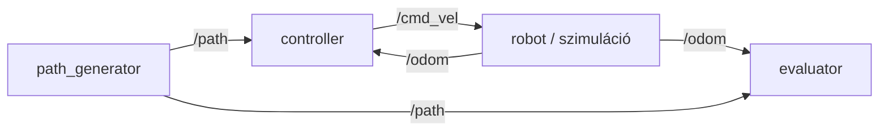

# `path_tracking_compare` package

ROS 2 Python csomag. [](https://docs.ros.org/en/humble/)

Nagy féléves beadandó az Autonóm járművek és robotok programozása tárgyhoz.

> [!NOTE]
> A projekt fejlesztés alatt áll.

## A projekt célja

Két klasszikus útvonalkövető szabályozó, a **Pure Pursuit** és a **Stanley**, összehasonlítása szimulált roboton. A robot egy előre megadott pályát követ, a szabályozók teljesítményét pedig a követési hiba alapján mérem különböző sebességeken és paraméterekkel.

## Tervezett felépítés

Három node-ból fog állni a csomag, ezek topicokon keresztül beszélnek egymással:



| Node | Feladat |
|---|---|
| `path_generator` | a referencia pálya előállítása és publikálása |
| `controller` | Pure Pursuit vagy Stanley szabályozó (paraméterrel választható) |
| `evaluator` | követési hiba mérése, eredmények mentése |

## Telepítés és build

A workspace helye: `~/ros2_ws/`.

### A csomag klónozása
``` r
cd ~/ros2_ws/src
```
``` r
git clone https://github.com/Vikesz-g2662b/path_tracking_compare
```

### Build
``` r
cd ~/ros2_ws
```
``` r
colcon build --packages-select path_tracking_compare --symlink-install
```

<details>
<summary> A ROS parancsok előtt source-olás.</summary>

``` bash
source ~/ros2_ws/install/setup.bash
```
</details>

## Felhasznált források

- A csomag a [sze-info/ros2_py_template](https://github.com/sze-info/ros2_py_template) sablonból készült.
